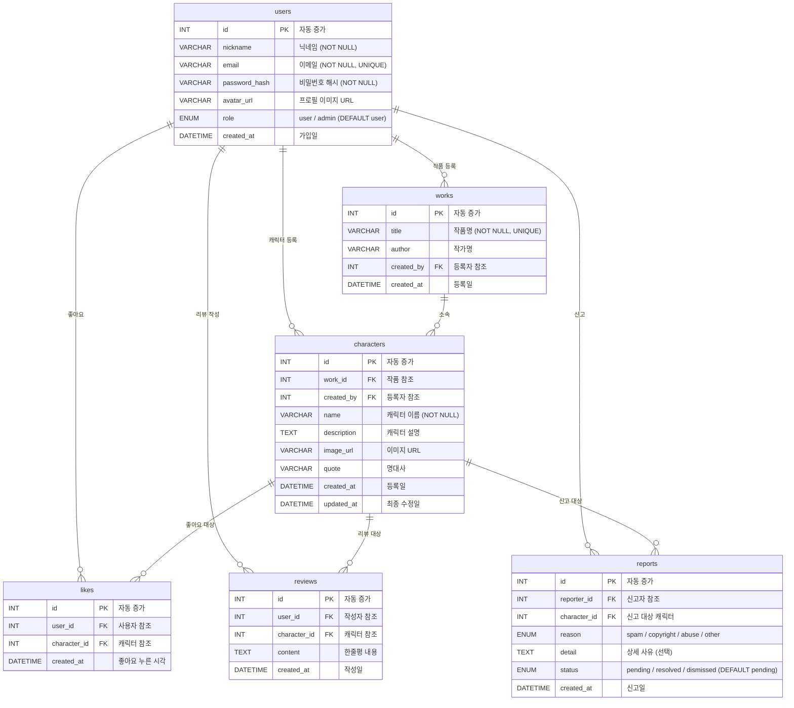

# ERD — Charapedia (웹소설 캐릭터 도감 + 팬 커뮤니티)

## 1. ER 다이어그램 (Mermaid)

## 2. 테이블 상세

### 2.1 users

| 컬럼 | 타입 | 제약조건 | 설명 |
|------|------|---------|------|
| id | INT | PK, AUTO_INCREMENT | 고유 식별자 |
| nickname | VARCHAR(50) | NOT NULL | 닉네임 |
| email | VARCHAR(100) | NOT NULL, UNIQUE | 이메일 (로그인 ID) |
| password_hash | VARCHAR(255) | NOT NULL | bcrypt 해시 |
| avatar_url | VARCHAR(255) | nullable | 프로필 이미지 |
| role | ENUM | NOT NULL, DEFAULT 'user' | user / admin |
| created_at | DATETIME | NOT NULL | 가입일 |

### 2.2 characters

| 컬럼 | 타입 | 제약조건 | 설명 |
|------|------|---------|------|
| id | INT | PK, AUTO_INCREMENT | 고유 식별자 |
| work_id | INT | FK → works(id) | 소속 작품 |
| created_by | INT | FK → users(id) | 등록자 (수정/삭제 권한 확인용) |
| name | VARCHAR(100) | NOT NULL | 캐릭터 이름 |
| description | TEXT | nullable | 캐릭터 설명 |
| image_url | VARCHAR(255) | nullable | 이미지 URL |
| quote | VARCHAR(500) | nullable | 명대사 |
| created_at | DATETIME | NOT NULL | 등록일 |
| updated_at | DATETIME | NOT NULL | 최종 수정일 |

### 2.3 likes

| 컬럼 | 타입 | 제약조건 | 설명 |
|------|------|---------|------|
| id | INT | PK, AUTO_INCREMENT | 고유 식별자 |
| user_id | INT | FK → users(id) | 좋아요 누른 사용자 |
| character_id | INT | FK → characters(id) | 대상 캐릭터 |
| created_at | DATETIME | NOT NULL | 좋아요 시각 |

**UNIQUE KEY:** `(user_id, character_id)` — 중복 좋아요 DB 레벨에서 방지

### 2.4 reports

| 컬럼 | 타입 | 제약조건 | 설명 |
|------|------|---------|------|
| id | INT | PK, AUTO_INCREMENT | 고유 식별자 |
| reporter_id | INT | FK → users(id) | 신고자 |
| character_id | INT | FK → characters(id) | 신고 대상 |
| reason | ENUM | NOT NULL | spam / copyright / abuse / other |
| detail | TEXT | nullable | 상세 사유 |
| status | ENUM | NOT NULL, DEFAULT 'pending' | pending / resolved / dismissed |
| created_at | DATETIME | NOT NULL | 신고일 |

**UNIQUE KEY:** `(reporter_id, character_id)` — 동일 사용자의 중복 신고는 신고 횟수에 반영되지 않음 (이미 신고한 경우 안내만 표시)

## 3. 설계 결정 사항

### 좋아요 수 실시간 계산
characters 테이블에는 좋아요 수를 별도 컬럼으로 저장하지 않고, 조회 시 `COUNT(l.id)`로 실시간 계산한다. 랭킹 페이지도 동일한 방식으로 정렬한다.

### 캐릭터 삭제 시 연쇄 삭제 (CASCADE)
캐릭터가 삭제되면 관련된 `likes`, `reviews`, `reports` 레코드도 `ON DELETE CASCADE`로 함께 삭제한다. 관리자가 신고 처리로 캐릭터를 삭제할 때 고아 레코드가 남지 않도록 한다.

### 신고 처리 흐름
1. 사용자가 신고 → `reports`에 `status = pending`으로 저장 (본인이 이미 신고한 캐릭터면 저장하지 않고 안내만)
2. 관리자 대시보드에서 캐릭터별 신고 건수(`COUNT(status = pending)`)와 사유를 확인
3. 관리자가 "삭제" 선택 → 캐릭터 삭제 + 해당 캐릭터의 모든 신고를 `resolved`로 변경 (삭제로 캐릭터 자체가 사라지므로 사실상 함께 정리됨)
4. 관리자가 "반려" 선택 → 해당 신고들을 `dismissed`로 변경, 캐릭터는 유지

### 권한 체크
- 캐릭터 수정/삭제: `character.created_by === req.user.id || req.user.role === 'admin'`
- 리뷰 삭제: `review.user_id === req.user.id` (관리자 삭제 권한은 시간이 남으면 확장 기능으로 고려)
- 신고 처리(삭제/반려): `req.user.role === 'admin'` 만 가능
